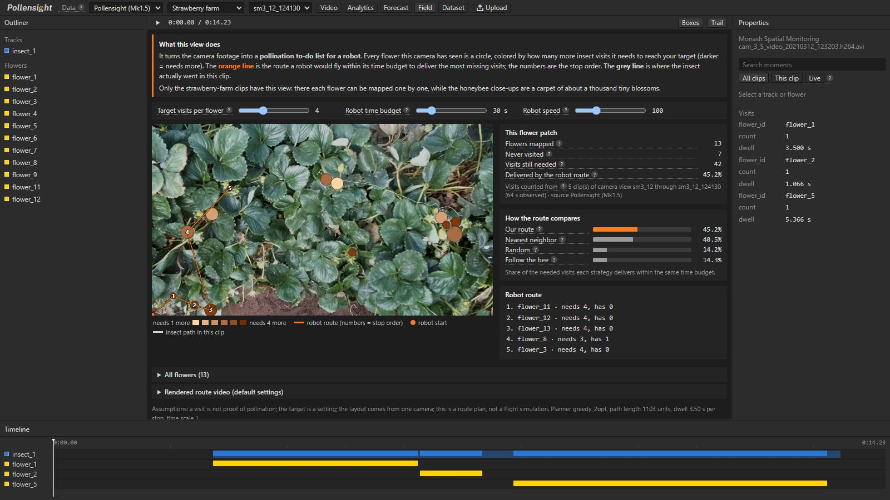
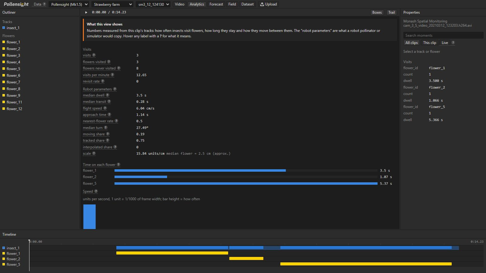
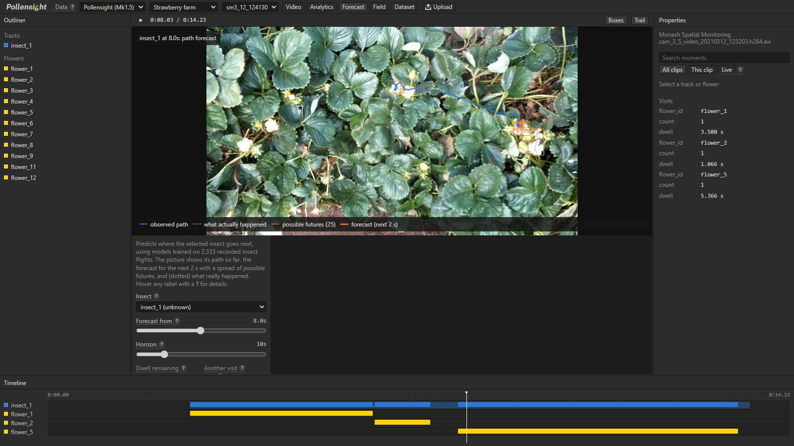
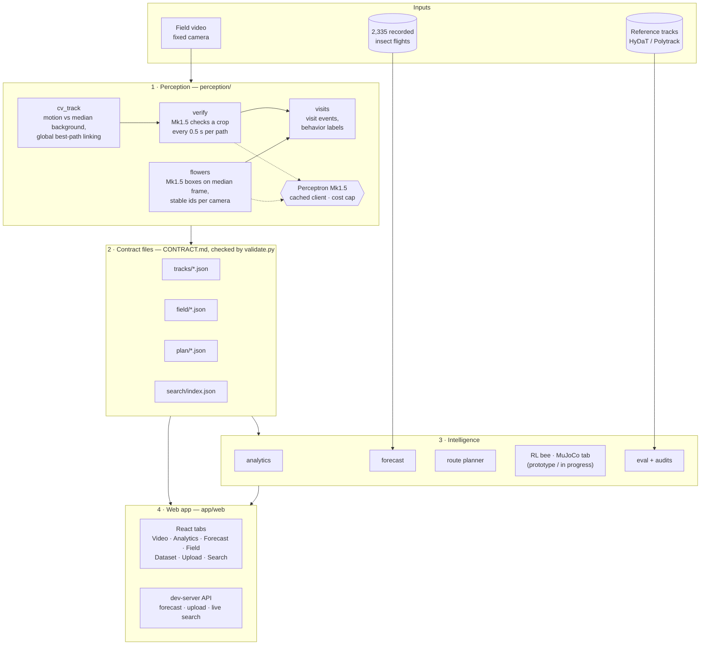

# Pollensight

**Ordinary field video in; a per-flower pollination map, insect-behavior analytics, forecasts, and a robot
pollinator's route out.**

Pollensight watches insects visiting flowers in a fixed-camera video, tracks every insect, maps every flower, counts
who visited what and for how long, predicts where each insect goes next, and plans the route a robot pollinator
should fly to cover the flowers the insects missed. Perception is built on Perceptron's **Mk1.5** vision model,
combined with classical computer vision where that is more reliable, and every number in this README is measured
and reproducible from this repository.


---

## Contents

1. [Problem](#1-problem)
2. [Solution overview](#2-solution-overview)
3. [Features](#3-features)
4. [Architecture](#4-architecture)
5. [Data](#5-data)
6. [Results](#6-results)
7. [Process: what we tried, what failed, what we kept](#7-process-what-we-tried-what-failed-what-we-kept)
8. [Testing and validation](#8-testing-and-validation)
9. [Recreate it](#9-recreate-it)
10. [Simulation and robotics](#10-simulation-and-robotics)
11. [Limitations](#11-limitations)
12. [Roadmap](#12-roadmap)
13. [Repository layout](#13-repository-layout)
14. [Cost](#14-cost)
15. [Team, credits and licenses](#15-team-credits-and-licenses)

---

## 1. Problem

About three quarters of the world's leading food crops (87 of 115) depend at least partly on animal pollination
([Klein et al. 2007](https://doi.org/10.1098/rspb.2006.3721)), and growers mostly manage it blind: they rent hives, hope the bees show up, and find out at harvest. Nobody measures **which flowers were
actually visited, how often, and for how long**, so nobody can say which flowers were left behind.

That gap matters more every year:

- **Pollinator decline and hive shortages** make "just add bees" expensive and unreliable.
- **Indoor and greenhouse farms** (strawberries, tomatoes, blueberries) often cannot rely on bees at all and
  pollinate by hand or with vibrating wands.
- **Robot pollinators** are emerging, but a robot needs to know *where to go*: which flowers still need visits, how
  long to stay on each, how fast to move between them. That knowledge lives in how real insects forage, and today
  it is locked inside video nobody analyzes.

The technical problem underneath: in field video, a bee is **15–30 pixels across**, moves fast, disappears behind
leaves, and sits among hundreds of flowers swaying in the wind. General-purpose vision models, asked to "track the
bee" through a whole clip, invent plausible-looking paths (we measured this, see [section 7](#7-process-what-we-tried-what-failed-what-we-kept)).

## 2. Solution overview

Pollensight turns a fixed-camera clip into structured, checkable data in four steps:

1. **Find every insect.** Because the camera does not move, anything that moves against the clip's median background
   is a candidate. A global best-path search links candidates into tracks and bridges short occlusions.
2. **Check with Mk1.5.** Each candidate path is sampled every 0.5 s; Mk1.5 is asked to detect an insect in a
   close-up crop. Paths where it consistently sees one are kept, so swaying flowers are dropped.
3. **Map the flowers.** Mk1.5 boxes every open flower on the clip's insect-free median frame. The same physical
   flower keeps the same id across all clips from one camera, so visits accumulate per real flower over time.
4. **Turn tracks into decisions.** Visits, dwell times and movement statistics (*analytics*); next-flower and
   short-term path predictions trained on 2,335 recorded insect flights (*forecast*); and a pollination deficit
   map with an optimized robot route (*field plan*).

Everything is browsable in a web app (video with overlays, search, analytics, forecast, field plan, accuracy) and
scriptable from the command line. Every Mk1.5 answer is cached, so the whole project replays offline at no cost.

## 3. Features

### The app (React + TypeScript, `app/web`)

| Tab | What it shows |
|---|---|
| **Video** | The clip with insect boxes, fading trails, flower boxes that light up during a visit, behavior labels (foraging / flying / walking), an outliner of tracks and flowers, a per-flower visit list and a timeline of when each insect is visible and on which flower. |
| **Search** (side panel) | Plain-English search over every clip, e.g. *"when does the bee land on a flower?"*; results jump the video to that moment. Free and instant over a pre-built index of moments; an optional **Live** mode asks Mk1.5 directly. |
| **Analytics** | Visits, flowers visited and never visited, revisit rate, and robot parameters: dwell time, transit time, flight speed (cm/s), approach time, nearest-flower rate, turn angles. Charts for time per flower and speed, a heatmap of where insects spent time, and tables of every move and visit. Every label has a hover explanation. |
| **Forecast** | Pick an insect and a moment: the predicted path for the next 2 s with a fan of possible futures, the real path for comparison, remaining dwell time, next-flower probabilities, the chance it leaves, and Monte Carlo rollouts of the next 5–30 s. |
| **Field** (farm clips) | The pollination to-do list: every mapped flower colored by how many more visits it needs, the robot route that delivers the most missing visits within a time budget, and how it compares to nearest-first, random and follow-the-insect. Sliders for target visits, budget and robot speed. |
| **Dataset** | Accuracy across all 48 clips: tracking vs the reference tracker, flower detection scored three ways, and the visual audits behind the numbers. |
| **Upload** | Analyze your own fixed-camera video (first 60 s): tracks, flowers, visits, analytics and a forecast, with or without Mk1.5. |
| **Data** selector | Switch every tab between **Pollensight (Mk1.5)**, **Motion only (no AI)**, **Reference tracker** and **Mock (test data)** to compare them. |







### Command line (Python)

| Command | Does |
|---|---|
| `python -m perception.pipeline --all` | Video → tracks, flowers, visits for all 48 clips (`tracks/*.json`) |
| `python -m perception.pipeline --video my.mp4 --species honeybee` | The same for any video |
| `python -m eval.run_eval` / `python -m eval.flowers_eval` | Tracking and flower accuracy reports |
| `python -m search.search query "wasp leaves the flower"` | Search from the terminal |
| `python -m forecast.train` / `python -m forecast.predict <clip> --t 9` | Train and run the forecasters |
| `python -m sim.run_plan --all` | Pollination maps, robot routes and rendered route videos |
| `python -m sim.train` / `python -m sim.rollout <clip>` | Reinforcement-learning bee policy (prototype) |

Full command reference: [RUNNING.md](RUNNING.md).

## 4. Architecture



**Design choices that matter**

- **Contract files between stages.** Every stage reads and writes small JSON files with a fixed schema
  ([CONTRACT.md](CONTRACT.md)), checked by `scripts/validate.py`. Teammates built perception, planning and the app in
  parallel against these files, and any stage can be rerun or replaced on its own.
- **One cached client for every Mk1.5 call** (`perception/client.py`): requests are keyed by model, prompt, media
  bytes and settings, answers are stored under `tracks/raw/`, spend is logged per person in `costs/`, and calls stop
  at a $40 cap. `BEEBOT_OFFLINE=1` replays everything from cache with the network off.
- **Classical vision where it is reliable, Mk1.5 where it adds judgment.** Motion finds where something moved; Mk1.5
  decides whether it is an insect and where the flowers are.
- **The app reads files, not a database.** The Vite dev server serves the repository's folders directly and calls
  Python only for live work (forecast, upload, live search).

## 5. Data

| | Honeybee close-ups (`hb*`) | Strawberry farm (`sm*`) |
|---|---|---|
| Source | Ratnayake, Dyer, Dorin (2020), *Honeybee video tracking data*, Monash University, [doi:10.26180/5f4c8d5815940](https://doi.org/10.26180/5f4c8d5815940) | Ratnayake, Amarathunga, Zaman, Dyer, Dorin (2022), *Spatial Monitoring and Insect Behavioural Analysis Dataset*, Monash University, [doi:10.26180/21533760](https://doi.org/10.26180/21533760) |
| Scene | Honeybees on Scaevola ground cover (dense purple blossoms), folding ruler in shot | Overhead camera over strawberry plants |
| Raw video | 7 videos, 1920×1080, 60 fps, 27–71 s | 2 test videos (T6, T7), 1920×1080, 30 fps, 10 min |
| Working clips | **38** consecutive 10 s windows | **10** clips of 7–15 s cut around insect activity, from 2 cameras |
| Reference tracks | HyDaT tracker output, one bee per video | Polytrack output with flower positions and visits |
| Extra | Human-counted visible frames (`Experiment1-Results.xlsx`) | **2,335 insect trajectories** from 52 camera stations (used to train the forecasters) |

- **48 clips total**, re-encoded to 1280×720 at 30 fps (104 MB), with a reference for 46 (two windows have no bee).
- **The reference is a tracker, not hand labels.** Scores against it are *agreement with a reference tracker*.
  The honeybee reference follows **one** bee per video, while many videos contain several.
- **Farm reference timing was corrected.** Its timestamps were off by a constant per source video (−0.3 s and
  +1.4 s). Found by sweeping the time shift against our motion tracker, which never sees the reference, and
  confirmed visually ([DATA_NOTES.md](DATA_NOTES.md), `scripts/fix_truth_offsets.py`).
- Both datasets are CC BY 4.0. Details: [DATA_NOTES.md](DATA_NOTES.md).

## 6. Results

All numbers come from files in this repository and can be regenerated with the commands in
[section 9](#9-recreate-it).

### Tracking (48 clips, vs the reference tracker)

| Method | Coverage | Median error | Disputed points | Visit recall | Visit precision |
|---|---|---|---|---|---|
| **Pollensight (Mk1.5)** | **0.90** | **3.5 units** | 0.53 (true rate ≈ 0.09–0.18, see below) | 0.57 | **0.90** |
| Motion only (no AI) | 0.93 | 3.5 units | 0.59 | 0.50 | 0.64 |
| Mk1.5 alone, whole clip (1 clip) | 0.04 | 259 units | | | |

- *Coverage* = share of reference points matched within 50 units (0–1000 scale) at the same time. *Median error*
  3.5 units ≈ 3–4 px at 720p, a fraction of a bee's width. Visits are scored on the farm clips, where the reference has flowers.
- **What Mk1.5 adds.** Motion alone already finds where insects move (slightly higher raw coverage, because it keeps
  everything that moves); Mk1.5 removes non-insects and supplies the flower map, which lifts visit precision from
  0.64 to 0.90 and visit recall from 0.50 to 0.57.
- **"Disputed points" overstate errors.** In a visual audit of 30 random points the reference has nothing near, 20
  were clearly real bees, 5 probably, and 5 were not insects: the reference follows one bee, the videos often
  have several ([`eval/audit/`](eval/audit)).

### Flower detection (10 farm clips = 2 camera scenes)

| Scored against | Precision | Recall |
|---|---|---|
| Visual audit of every open flower | **0.98** | **0.87** |
| Dataset flower list, centers within one flower width | 0.57 | 0.86 |
| Dataset flower list, box overlap ≥ 0.3 | 0.36 | 0.54 |

The dataset's list holds only the flowers its own tracker used, as squares estimated from a radius and offset about
13 px on one camera, so most "extra" boxes are real flowers. Per scene: camera 2, 9 of 9 boxes are open flowers and
all 9 found; camera 3, 11 of 13 and 11 of 13 found. The audit labels are AI-assisted visual judgments and should be
spot-checked by a person before being quoted as ground truth.

### Forecasting (11 camera stations held out of training)

| Task | Pollensight | Baselines |
|---|---|---|
| Next flower, correct in top 3 | **79%** | nearest flower 68%, random 49% |
| Next flower, top 1 | 43% | nearest flower 42% |
| 2 s position error, moving insects | 68.5 units (median of neighbors) | stays put 73.8, constant velocity 235 |
| Closest of 25 sampled futures, after 2 s | **8 units (≈ 0.3 cm)** | |
| Visits another flower at all | 68% accuracy | always-yes 66% |

An insect's next 2 seconds are genuinely multi-modal (land here, or fly past), so the **fan of possible futures**
is the useful output, not a single line. The "another visit" model is weak and is shown only as a probability.

### Robot planning (10 farm clips, default settings: 4 visits per flower, 30 s budget)

| Strategy | Share of missing visits delivered |
|---|---|
| **Pollensight planner** (greedy + 2-opt) | **39–56%** |
| Nearest flower first | 37–56% |
| Random order (average of 20) | 17–33% |
| Follow the insect | 7–14% |

On camera 3 the planner beats nearest-first on 4 of 5 clips and ties on the fifth; on camera 2 every flower needs
the same number of visits and the two tie. That is expected: with only minutes of footage most flowers have equal
needs, which is exactly when nearest-first is near optimal, and the planner's advantage grows as needs differ.

## 7. Process: what we tried, what failed, what we kept

| Step | Finding | Decision |
|---|---|---|
| Ask Mk1.5 to track the bee through a whole clip | Returned an evenly spaced straight line across the frame; **3.9%** coverage. The bee is ~20 px and a 10 s clip reaches the model as ~9k tokens. | Mk1.5 never tracks; it judges small crops. |
| Motion tracking against the median background | Finds the bee in every honeybee clip checked (best path ~99% on target), but frame-to-frame linking also produced 64–203 candidate tracks per clip, mostly swaying flowers, and broke each bee into many pieces. | Replaced the linking with a global best-path search (bridges gaps up to 0.5 s) and kept it as the candidate generator. |
| Mk1.5 yes/no questions on crops (64 crops labelled from the reference) | Found only 30–57% of real bees. | Rejected. |
| Mk1.5 *detection* on crops | Finds 93% of bees but boxes something in about half the bee-free crops. | One crop is weak evidence; **decide per path** (keep if ≥ 70% of its crops show an insect; threshold swept 0.5–0.95). |
| Mk1.5 species questions | Answered "hoverfly" for honeybees and wasps alike. | Species come from dataset metadata or the user. |
| Farm reference timing | Agreement jumped from ~30% to > 90% when shifted by a constant per video. | Corrected the reference, documented, visually confirmed. |
| Flower inventory on honeybee close-ups | ~1,000 blossoms per clip; 43 of 76 answers hit the 6,000-token limit. | Dense ground cover is detected and skipped; where the bee stops becomes the flower. |
| Flower detector variants (strawberry prompt, 3×3 tiles, propose-then-confirm) | None beat the current detector on balance (best F1 0.930 vs 0.927 at 4.5× cost). | Kept the detector; added cross-clip filling (a flower seen in ≥ 2 clips of a camera exists in all). |
| Overlapping flower zones | One insect "visited" two flowers at once, giving negative transit times. | Each moment belongs to the nearest flower; visit precision rose from 0.85 to 0.90. |
| Forecasting | Mean of neighbors blurs "lands here" and "flies past"; constant velocity fails because bees turn sharply. | Median of 50 neighbors for the line, 25 neighbors' futures for the fan. |

Two teams built trackers in parallel; on the same evaluation the pipeline above covered 90% of the reference path
against 38% for a 2-fps hybrid, and was better on 45 of 46 clips. That run is kept in `tracks/hybrid/` for
comparison.

## 8. Testing and validation

| Layer | How it is checked |
|---|---|
| **Unit tests** | `python -m pytest -q`: **45 tests**, all offline. A fake Mk1.5 client replaces the network, so caching, parsing, path splitting, visit logic, stable flower ids, the fill step, analytics, search, forecasting features, flower detection and the RL environment are tested without API calls. |
| **File contract** | `python -I scripts/validate.py`: every track, truth and mock file against CONTRACT.md (**144/144 valid**). |
| **Accuracy** | `python -m eval.run_eval` (tracking, visits) and `python -m eval.flowers_eval` (flowers, three ways). Reports in `eval/`. |
| **Visual audits** | Disputed tracking points and every flower box were inspected on crops; images and labels in `eval/audit/`. |
| **Forecast evaluation** | Trained and scored with whole camera stations held out, so scores reflect unseen flower patches. |
| **Reproducibility** | Re-running the pipeline offline from cache reproduces the committed track, field and plan files exactly, with zero paid calls. |
| **App** | `npm run build` type-checks the whole front end; every tab was exercised in a headless browser on both clip sets at two window sizes with no page errors or failed requests. |

## 9. Recreate it

### What you need

| Tool | Version | Install (Windows) | Install (Mac) |
|---|---|---|---|
| Python | 3.10+ | `winget install Python.Python.3.11` | `brew install python@3.11` |
| Node.js | 20.19+ or 22.12+ | `winget install OpenJS.NodeJS.LTS` | `brew install node` |
| Git + GitHub CLI | current | `winget install Git.Git GitHub.cli` | `brew install git gh` |
| ffmpeg | current | `winget install Gyan.FFmpeg` | `brew install ffmpeg` |

A Perceptron API key is needed **only** to run Mk1.5 on new footage. Everything in this repository replays from
the committed cache without one.

### A. Run the app on the committed results (about 10 minutes)

```bash
gh auth login
gh repo clone b-ananya/pollensight && cd pollensight

python -m venv .venv
.venv\Scripts\activate                 # Mac/Linux: source .venv/bin/activate
pip install -r requirements.txt
cp .env.example .env                   # optional: add PERCEPTRON_API_KEY

gh release download data-v1 --pattern "beebot-data-v1.zip"       # 48 clips, 104 MB
python -I -c "import zipfile; zipfile.ZipFile('beebot-data-v1.zip').extractall('.')"
python -I scripts/validate.py

python -m forecast.train               # downloads 2,335 trajectories (100 MB) once, ~1-2 min

cd app/web
npm install
npm run dev                            # open http://localhost:5173
```

If your Python environment lives outside the repository, set `BEEBOT_PYTHON` in `.env` to its interpreter so the
app can run forecasts and uploads ([app/web/SETUP.md](app/web/SETUP.md)).

### B. Reproduce every result

```bash
python -m perception.pipeline --all            # tracks, flowers, visits (free: all Mk1.5 answers are cached)
python -m perception.pipeline --all --no-api   # the motion-only baseline -> tracks/heuristic/
python -m eval.run_eval                        # -> eval/report.json
python -m eval.run_eval --pred tracks/heuristic --out eval/report_heuristic.json
python -m eval.flowers_eval                    # -> eval/flowers_report.json
python -m search.search build                  # -> search/index.json
python -m sim.run_plan --all                   # -> field/, plan/, rollouts/*_plan.mp4
python -m pytest -q                            # 45 tests, offline
```

Set `BEEBOT_OFFLINE=1` to guarantee no network calls: any request not already cached fails instead of being sent.

### C. Rebuild the dataset from the original sources

```bash
python -I scripts/fetch_data.py       # downloads only the needed parts of the Monash archives
python -I scripts/prepare_data.py     # cuts the 48 working clips and writes truth/ + clips/manifest.json
python -m scripts.fix_truth_offsets --apply
```

### D. Analyze your own video

Use **Upload** in the app, or:

```bash
python -m perception.pipeline --video my_bees.mp4 --species honeybee
```

Works best with a camera that does not move (tripod or mount), insects at least ~15 px across, and the first 60 s
of footage. Species is a setting because Mk1.5 cannot tell species apart at this size.

## 10. Simulation and robotics

| Piece | Status | What it does |
|---|---|---|
| **Route planner** (`sim/planner.py`, Field tab) | Working | Orienteering: choose and order flowers to deliver the most missing visits within a time budget (greedy insertion + 2-opt), with nearest-first, random and follow-the-insect baselines. Robot dwell time comes from the insects' median dwell. |
| **Reinforcement-learning bee** (`sim/field_env.py`, `sim/train.py`) | Prototype | A Gymnasium field environment calibrated with measured bee speed and dwell; a PPO policy trained for ~5 minutes on random fields ties the greedy baseline on the 10 real layouts (6.5 visits per 30 s each). `sim/predict.py` turns any flower photo into a predicted bee path. |
| **MuJoCo bee simulation** (new tab) | **In progress** | A MuJoCo model of a bee hopping from flower to flower on the mapped flower layout, shown in its own app tab to demonstrate simulated foraging behavior. It is driven by the same waypoints the forecaster and RL policy produce (`rollouts/<clip>_rl.json`). |
| **MuJoCo robot replay** | Planned (stretch) | A Crazyflie 2 from MuJoCo Menagerie replays the planned robot route in 3D over the clip's first frame ([PLAN.md](PLAN.md), stretch goal 5). |

The simulations are kinematic replays and policies on a flat map: **visual demonstrations of behavior, not flight
physics.**

## 11. Limitations

- **A visit is not pollination.** We measure insect presence on a flower, not pollen transfer. The target number of
  visits per flower is a setting, not a biological claim.
- **The reference is a tracker, not ground truth**, and on honeybee clips it follows only one of several bees.
- **Two farm scenes.** Flower scores come from 2 fixed-camera scenes; the audit labels need a human spot-check.
- **Species identification does not work** at this resolution with Mk1.5 (every insect was called a hoverfly).
- **Forecasts are trained on the farm cameras**; on the honeybee close-ups they are qualitative.
- **Scale is approximate**: the ruler in shot on honeybee clips, an assumed 2.5 cm strawberry flower on farm clips
  (a citation for that size is still to be added).
- **Short footage.** Clips are 7–15 s, so per-clip rates (visits per minute) are rough and deficit maps fill in
  slowly.

## 12. Roadmap

1. **MuJoCo simulation tab**: a bee hopping between the mapped flowers, then the robot replaying its route.
2. **Bee-aware planning**: skip flowers the forecaster expects an insect to visit soon, so the robot complements
   the bees instead of duplicating them.
3. **Flower state** (bud, open, pollinated, fruit) from close-up crops, so only receptive flowers get a deficit.
4. **From visits to yield**: follow each flower (stable ids already exist) through to the fruit it sets, and learn
   which visit patterns produce good fruit. This is the step that turns "visit counts" into "pollination".
5. **Higher-resolution capture** (4K or macro) to unlock species identification.
6. **Greenhouse pilot** with a low-cost arm (brush end-effector) executing the planned route on real plants.

## 13. Repository layout

```
analytics/      metrics.py: visits, dwell, transit, speed, revisits, approach, turns (robot parameters)
app/web/        the React + TypeScript app (Vite); server/apis.ts calls Python for forecast, upload, live search
app/render.py   burn overlays into an mp4 without the app
clips/          manifest.json (git) + 48 working clips (from the data release)
costs/          per-person log of every paid Mk1.5 call
data/spatial/   farm flower positions and visit summaries (small CSVs from the trajectory dataset)
docs/img/       screenshots used in this README
eval/           run_eval.py, flowers_eval.py, reports, audit/ (images + labels behind the numbers)
field/ plan/    pollination maps and robot routes per farm clip; truth/ subfolders for the reference versions
forecast/       Polytrack loader, path + next-flower models, training, prediction, report.json
perception/     client (cached Mk1.5), cv_track, verify, flowers, visits, pipeline, plus the earlier hybrid tracker
prompts/        Mk1.5 prompts and notes from prompt tuning
rollouts/       rendered route and simulation videos (mp4s are not in git)
scripts/        data download/preparation, contract validator, reference timing fix
search/         moment index builder and query
sim/            route planner, renderers, RL environment and policy
tests/          offline unit tests
tracks/         tracks/*.json = pipeline output; heuristic/, hybrid/, mock/, parts/; raw/ = cached Mk1.5 answers
truth/          reference tracks in the same format
```

Further documentation: [RUNNING.md](RUNNING.md) (all commands), [CONTRACT.md](CONTRACT.md) (file formats),
[DATA_NOTES.md](DATA_NOTES.md) (data provenance and fixes), [PLAN.md](PLAN.md) (hackathon plan and roles),
[app/web/SETUP.md](app/web/SETUP.md) (app setup), [sim/README.md](sim/README.md) (RL prototype).

## 14. Cost

Every paid Mk1.5 call in this project, across the whole team, was logged: **about 10,900 calls for $1.53 in
total** (`costs/*.csv`), at $0.15 per million input tokens and $1.50 per million output tokens. Checking a crop
costs about $0.0001; a full run of the pipeline over all 48 clips cost under $1. All answers are cached in
`tracks/raw/` (51 MB), so re-running anything here is free.

## 15. Team, credits and licenses

Built by **b-ananya**, **Raika Roy Choudhury**, **Falisha Amir** and **Flora** during a hackathon, with AI coding
assistants (Claude Code, Cursor) credited in the commit history.

- **Perception model:** Perceptron Mk1.5.
- **Data:** Monash University datasets above, CC BY 4.0. Please cite both DOIs when using results derived from them.
- **Robot model (planned):** Bitcraze Crazyflie 2 from MuJoCo Menagerie, under Menagerie's own license; Menagerie
  is cloned outside this repository and never committed.
