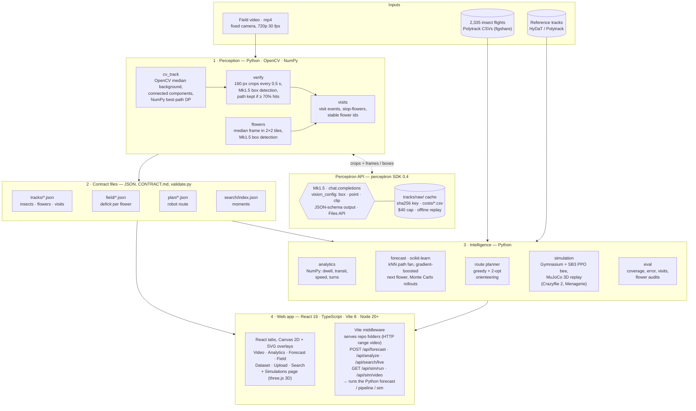

# Pollensight

**Problem:** Pollinators are disappearing, and a third of the food we grow depends on them.

**Solution:** Pollensight turns ordinary fixed-camera video into a per-flower record of insect visits. It uses
motion tracking plus Perceptron's Mk1.5 vision model, then forecasts insect movement and plans a robot route to the
flowers that were missed.

**Demo video and project page:** [Pollensight on Devpost](https://devpost.com/software/beebot-zbaxvy)

## Features

| Feature | What it does |
|---|---|
| **Video** | Insect boxes, trails, flower boxes that light up during visits, and a timeline |
| **Search** | Plain-English search across clips ("when does the bee land on a flower?") that jumps the video to the moment |
| **Analytics** | Visits, dwell time, transit time, flight speed, revisits and a time-spent heatmap; hover any label for its meaning |
| **Forecast** | Predicted next 2 s of the insect's path (with a spread of possible futures), next-flower odds and dwell remaining |
| **Field** (farm clips) | Flowers colored by visits still needed, and the robot route that covers the most within a time budget |
| **Dataset** | Accuracy across all clips, with the visual audits behind the numbers |
| **Upload** | Analyze your own fixed-camera video |
| **Simulations** (own page) | An RL-trained bee flies over a random flower field it has never seen, in interactive 3D (rotate, zoom, scrub); the same flight renders in **MuJoCo** as a video, with a Crazyflie 2 drone standing in for the bee |

## Architecture



Each stage reads and writes small JSON files with a fixed format ([CONTRACT.md](CONTRACT.md)). Every Mk1.5 answer
is cached in `tracks/raw/`, so everything replays offline at no cost.

## Tech stack

| Layer | Tools |
|---|---|
| **Perception** | Python 3.10+, **OpenCV** (video decoding, median background, connected components), **NumPy** (dynamic-programming path linking) |
| **Vision model** | **Perceptron Mk1.5** through the `perceptron` SDK 0.4: `chat.completions` with image and video inputs, `vision_config.annotation_format` = `box` / `point` / `clip` for boxes and time ranges, JSON-schema constrained output, and the Files API for video uploads |
| **API caching & cost** | Our own client (`perception/client.py`): SHA-256 request keys, JSON answer cache in `tracks/raw/`, per-person CSV cost log, $40 spending cap, offline replay mode; key loaded with `python-dotenv` |
| **Forecasting** | **scikit-learn** (`NearestNeighbors` path fan, `HistGradientBoostingClassifier` next flower, `LogisticRegression`, `StandardScaler`, `GroupShuffleSplit` held-out stations), **pandas** for the trajectory CSVs, **joblib** for saved models |
| **Planning & simulation** | Orienteering planner in plain Python (greedy insertion + 2-opt); **Gymnasium** environment + **Stable-Baselines3** PPO for the RL bee; **MuJoCo 3.2+** for the 3D replay (kinematic, not flight physics) with the Bitcraze **Crazyflie 2** model from **MuJoCo Menagerie**; **SciPy** cubic splines to smooth the flight path |
| **Video** | **ffmpeg** via `imageio-ffmpeg` (H.264 rendering, upload transcoding) |
| **Web app** | **React 19** and **react-dom**, **TypeScript**, **Vite 8** with `@vitejs/plugin-react`, and hand-written CSS. Video overlays are **Canvas 2D**; the field view is **SVG**. The Simulations page is **three.js** (WebGL): OrbitControls, Line2 for the flight path, and OBJLoader for the Crazyflie mesh. A custom Vite middleware serves the repo's folders (HTTP range requests for video) and exposes `GET /api/health`, `POST /api/forecast`, `/api/analyze`, `/api/search/live`, `GET /api/sim/run`, `/api/sim/video`, which run Python through Node's `child_process`. Needs Node 20.19+. |
| **Data & testing** | Clips shipped as a **GitHub Release**; raw datasets from **figshare** (read with HTTP range requests, so only the needed files download); JSON file formats in [CONTRACT.md](CONTRACT.md) checked by a stdlib validator; **pytest** with a fake API client, so tests run offline |
| **Development** | Written in the **Cursor** IDE with the **Grok** model, and with **Claude Code**. |

## Data

There are 48 clips (720p, 30 fps), from two Monash University datasets (CC BY 4.0):

- **38 honeybee close-ups:** 10 s each, honeybees on dense ground cover.
  Ratnayake, Dyer, Dorin (2020), [doi:10.26180/5f4c8d5815940](https://doi.org/10.26180/5f4c8d5815940).
- **10 strawberry-farm clips:** 7–15 s each, from two overhead cameras, plus 2,335 recorded insect flights used to
  train the forecaster. Ratnayake et al. (2022), [doi:10.26180/21533760](https://doi.org/10.26180/21533760).

Each dataset comes with its authors' own tracker output, which we use as the reference. Details are in
[DATA_NOTES.md](DATA_NOTES.md).

## Results

| | Result |
|---|---|
| Insect tracking (48 clips, vs reference tracker) | 90% of the path covered, median error ≈ 3–4 px |
| Visits (farm clips) | 90% of detected visits are real (64% without Mk1.5) |
| Flower boxes (vs visual audit) | 98% precision, 87% recall |
| Next flower (unseen camera stations) | right flower in the top 3 picks 79% of the time (nearest-flower guess: 68%) |
| Robot route | delivers 39–56% of missing visits in 30 s (random order: 17–33%) |

Tests: `python -m pytest -q` runs 45 tests offline, and `python -I scripts/validate.py` checks every data file
(144/144 valid).

## Recreate it

You need Python 3.10+, Node 20.19+, Git, the GitHub CLI and ffmpeg. A Perceptron API key is only needed for new
footage.

```bash
gh repo clone b-ananya/pollensight && cd pollensight
python -m venv .venv
.venv\Scripts\activate                 # Mac/Linux: source .venv/bin/activate
pip install -r requirements.txt
cp .env.example .env                   # optional: add PERCEPTRON_API_KEY

gh release download data-v1 --pattern "beebot-data-v1.zip"
python -I -c "import zipfile; zipfile.ZipFile('beebot-data-v1.zip').extractall('.')"
python -m forecast.train               # downloads the trajectory data once, ~2 min

cd app/web && npm install && npm run dev       # http://localhost:5173
```

To regenerate every result (free, because Mk1.5 answers are cached):

```bash
python -m perception.pipeline --all    # tracks, flowers, visits
python -m eval.run_eval                # tracking accuracy
python -m sim.run_plan --all           # pollination maps and robot routes
```

For the **Simulations** page (optional), install MuJoCo and fetch just the Crazyflie model from Menagerie, next to
the repo:

```bash
pip install -r requirements-stretch.txt          # mujoco, gymnasium, stable-baselines3
git clone --depth 1 --filter=blob:none --sparse https://github.com/google-deepmind/mujoco_menagerie ../mujoco_menagerie
git -C ../mujoco_menagerie sparse-checkout set bitcraze_crazyflie_2
```

If Menagerie lives elsewhere, set `MUJOCO_MENAGERIE` in `.env`. From the command line:
`python -m sim.mj_random --seed 7 --live` opens an interactive MuJoCo window.

To analyze your own video, use **Upload** in the app, or run
`python -m perception.pipeline --video my.mp4 --species honeybee`.

Full command reference: [RUNNING.md](RUNNING.md). App setup: [app/web/SETUP.md](app/web/SETUP.md).
