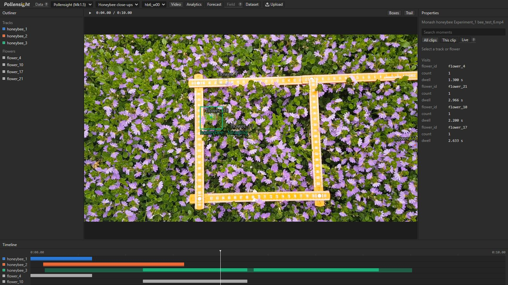
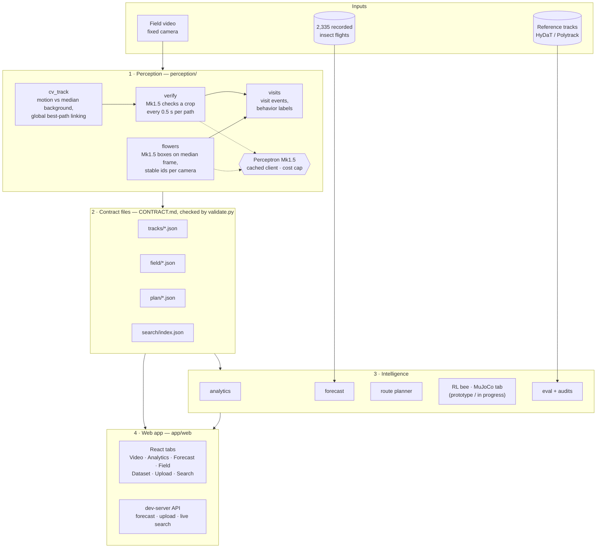

# Pollensight

**Problem:** Growers can't see which flowers insects actually pollinate, so missed flowers go unnoticed and robot
pollinators don't know where to go.

**Solution:** Pollensight turns ordinary fixed-camera video into a per-flower record of insect visits. It uses
motion tracking plus Perceptron's Mk1.5 vision model, then forecasts insect movement and plans a robot route to the
flowers that were missed.



## Features

| Feature | What it does |
|---|---|
| **Video** | Insect boxes, trails, flower boxes that light up during visits, and a timeline |
| **Search** | Plain-English search across clips ("when does the bee land on a flower?") that jumps the video to the moment |
| **Analytics** | Visits, dwell time, transit time, flight speed, revisits and a time-spent heatmap; hover any label for its meaning |
| **Forecast** | Predicted next 2 s of the insect's path (with a spread of possible futures), next-flower odds and dwell remaining |
| **Field** (farm clips) | Flowers colored by visits still needed, and the robot route that covers the most within a time budget |
| **Dataset** | Accuracy across all clips, with the visual audits behind the numbers |
| **Upload** | Analyze your own fixed-camera video |
| **Simulation** | Route planner and an RL bee prototype; a **MuJoCo tab** simulating a bee hopping from flower to flower is in progress |

## Architecture



Each stage reads and writes small JSON files with a fixed format ([CONTRACT.md](CONTRACT.md)). Every Mk1.5 answer
is cached in `tracks/raw/`, so everything replays offline at no cost.

## Data

There are 48 clips (720p, 30 fps), from two Monash University datasets (CC BY 4.0):

- **38 honeybee close-ups:** 10 s each, honeybees on dense ground cover.
  Ratnayake, Dyer, Dorin (2020), [doi:10.26180/5f4c8d5815940](https://doi.org/10.26180/5f4c8d5815940).
- **10 strawberry-farm clips:** 7–15 s each, from two overhead cameras, plus 2,335 recorded insect flights used to
  train the forecaster. Ratnayake et al. (2022), [doi:10.26180/21533760](https://doi.org/10.26180/21533760).

Each dataset comes with its authors' own tracker output, which we use as the reference. Details are in
[DATA_NOTES.md](DATA_NOTES.md).

## Results

| | Result |
|---|---|
| Insect tracking (48 clips, vs reference tracker) | 90% of the path covered, median error ≈ 3–4 px |
| Visits (farm clips) | 90% of detected visits are real (64% without Mk1.5) |
| Flower boxes (vs visual audit) | 98% precision, 87% recall |
| Next flower (unseen camera stations) | right flower in the top 3 picks 79% of the time (nearest-flower guess: 68%) |
| Robot route | delivers 39–56% of missing visits in 30 s (random order: 17–33%) |

Tests: `python -m pytest -q` runs 45 tests offline, and `python -I scripts/validate.py` checks every data file
(144/144 valid).

## Recreate it

You need Python 3.10+, Node 20.19+, Git, the GitHub CLI and ffmpeg. A Perceptron API key is only needed for new
footage.

```bash
gh repo clone b-ananya/pollensight && cd pollensight
python -m venv .venv
.venv\Scripts\activate                 # Mac/Linux: source .venv/bin/activate
pip install -r requirements.txt
cp .env.example .env                   # optional: add PERCEPTRON_API_KEY

gh release download data-v1 --pattern "beebot-data-v1.zip"
python -I -c "import zipfile; zipfile.ZipFile('beebot-data-v1.zip').extractall('.')"
python -m forecast.train               # downloads the trajectory data once, ~2 min

cd app/web && npm install && npm run dev       # http://localhost:5173
```

To regenerate every result (free, because Mk1.5 answers are cached):

```bash
python -m perception.pipeline --all    # tracks, flowers, visits
python -m eval.run_eval                # tracking accuracy
python -m sim.run_plan --all           # pollination maps and robot routes
```

To analyze your own video, use **Upload** in the app, or run
`python -m perception.pipeline --video my.mp4 --species honeybee`.

Full command reference: [RUNNING.md](RUNNING.md). App setup: [app/web/SETUP.md](app/web/SETUP.md).
